# Phong cách Studio

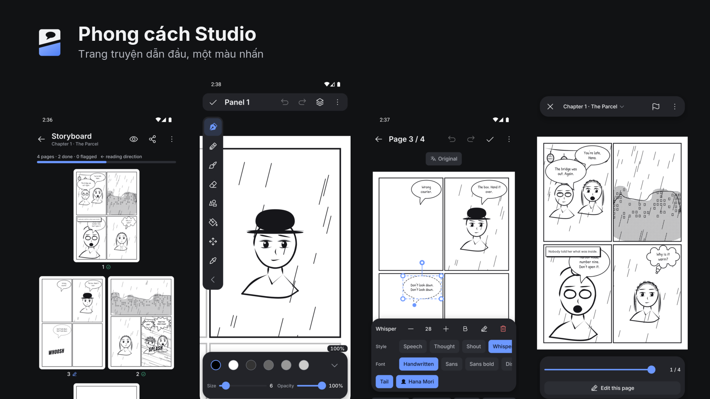

**Một xưởng in nhỏ: mực, giấy và vài màu riso.** App có màu và có hồn như một cuốn zine in tay, còn khi bạn vẽ thì mọi thứ lùi lại để tranh của bạn dẫn đầu.

Tài liệu này giải thích cảm giác của style và lý do đằng sau từng quyết định. Bảng tra token đầy đủ nằm ở [05-design-system.md](05-design-system.md).

## Bốn ý tưởng

| Ý tưởng | Nghĩa là gì | Nhìn thấy ở đâu |
| --- | --- | --- |
| **Làm bằng tay** | Tranh có nét run, hạt in và lệch màu. Không phát sáng, không bóng bẩy | Onboarding, bìa truyện, màn trống |
| **Màu đến từ mực** | San hô là màu nhấn của giao diện. Mỗi thể loại và tính năng có một màu mực riêng | Bìa, tile ở Project, nút chính |
| **Trang truyện dẫn đầu** | Khi làm việc, giao diện lùi lại và không cạnh tranh với tranh | Canvas, Lettering, Preview |
| **Chiều sâu bằng độ sáng** | Bề mặt càng nổi càng sáng. Gần như không dùng viền hay bóng | Thẻ, dock, sheet |

## Logo


Logo là chữ M in đậm, cắt tay như dao rọc giấy:

- **Nét chữ nghiêng, đầu nét vát:** cảm giác poster in tay, không phải phông chữ có sẵn.
- **Một nhát cắt chéo ở chân phải:** đường chia khung truyện, thứ làm nên một trang manga.
- **Hai màu mực:** chữ màu giấy trên nền san hô, giống một bản in riso.

Logo đọc được ở 48px, và có bản đơn sắc cho Themed Icons của Android 13 trở lên. File gốc ở `assets/icon/`. Sửa xong chạy `sh scripts/gen-icons.sh`, cần `rsvg-convert` và `magick`. Trong app dùng component `BrandMark`.

## Màn khởi động

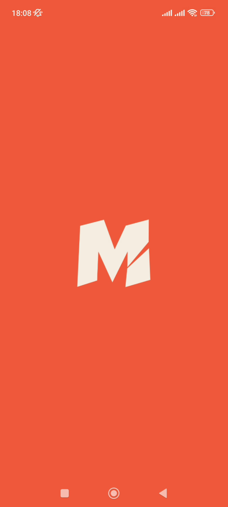

Từ lúc chạm icon, màn hình phủ san hô với chữ M ở giữa, nối liền với icon vừa bấm. Splash giữ nguyên tới khi màn đầu tiên đã vẽ xong (`hideSplash` chạy trong `onReady` của `NavigationContainer`), rồi mờ dần trong 220ms sang trang giấy, nên không có khoảng trắng hay chớp màu. Nếu JS không khởi động được, splash tự tắt sau 8 giây.

Khi splash rời đi, Android đặt lại màu thanh hệ thống theo theme. Vì vậy `AppTheme` phải khai `statusBarColor` trong suốt, và `MainActivity.applySystemBarIcons` áp lại màu icon sau đó.

## Màu

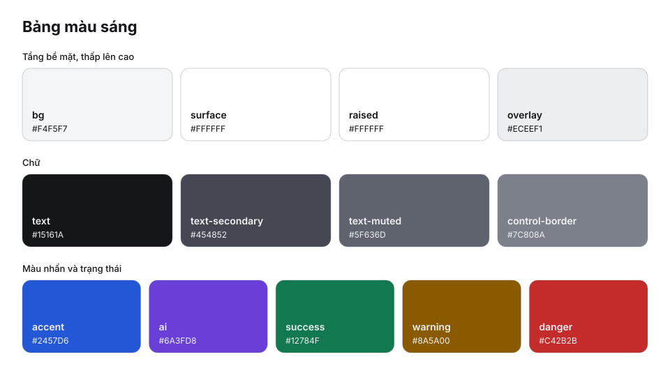

Giao diện mặc định là nền giấy kem, vì tranh riso hòa vào nền thành một tờ giấy. Màu nhấn đậm hơn để đạt độ tương phản. Đổi màu nào cũng phải chạy `__tests__/theme.contrast.test.ts`.

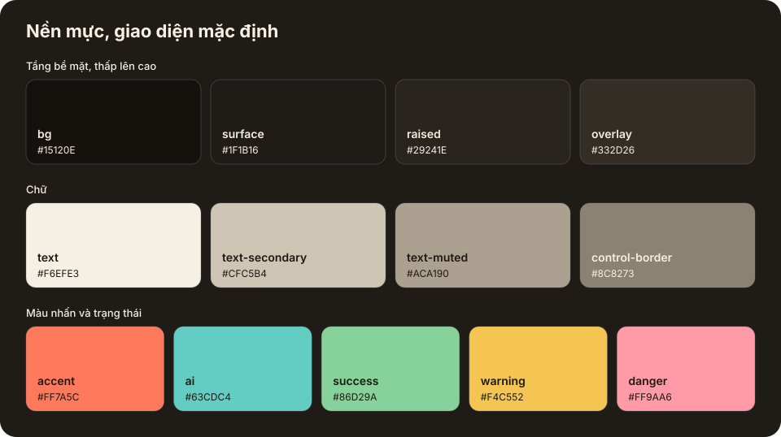

Nền tối chọn trong Profile. Đây là màu mực ấm, không phải xám lạnh. Bốn tầng bề mặt chênh nhau rất ít, đủ để thấy tầng mà không gây chú ý.

Ở giao diện tối, chữ trên nền `accent` luôn dùng `on-accent`, không dùng trắng. Chữ trắng trên `accent` chỉ đạt 2,56:1.

## Chữ

Giao diện dùng một phông duy nhất là **Inter**, có đủ dấu tiếng Việt. Thứ bậc đến từ cỡ chữ và độ đậm, không đến từ màu sắc hay phông thứ hai.

| Vai trò | Ví dụ | Token |
| --- | --- | --- |
| Tên màn gốc | Library | `display` 28, đậm |
| Thanh tiêu đề, sheet | Storyboard | `title` 20, nửa đậm |
| Tên nhóm, tên thẻ | Recent stories | `heading` 16, nửa đậm |
| Nội dung | Dòng mô tả, ô nhập | `body` 16 |
| Nút, chip, tab | Keep drawing | `label` 14, vừa |
| Số liệu nhỏ | 2/4 pages | `caption` 12, vừa |

Phông **trong trang truyện** là dữ liệu tranh, không thuộc giao diện: Patrick Hand cho thoại, Be Vietnam Pro cho chữ thường, Anton cho SFX.

## Tranh minh họa

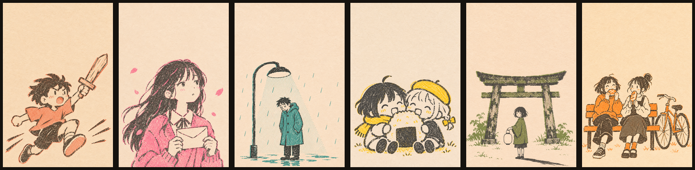

Mọi tranh là bản in riso: mực đen và **một** màu mực trên giấy kem, có hạt in, nét tay không đều và màu hơi lệch. Mỗi thể loại có màu riêng, và tranh thể loại dùng luôn làm bìa cho truyện chưa có ảnh.

| Thể loại | Màu mực |
| --- | --- |
| Shounen | San hô |
| Shoujo | Hồng |
| Seinen | Xanh ngọc |
| Chibi | Vàng hướng dương |
| Horror | Xanh rêu |
| Slice of life | Cam ấm |

Tranh được tạo bằng AI nên phải kiểm soát chặt để **không có cảm giác AI**: không neon, không phát sáng, không bóng bẩy, không chi tiết quá mức, không tím hồng. Nếu một tranh nhìn "quá AI", bỏ và làm lại. File ở `src/assets/art/`, đăng ký trong `src/ui/art.ts`.

## Icon

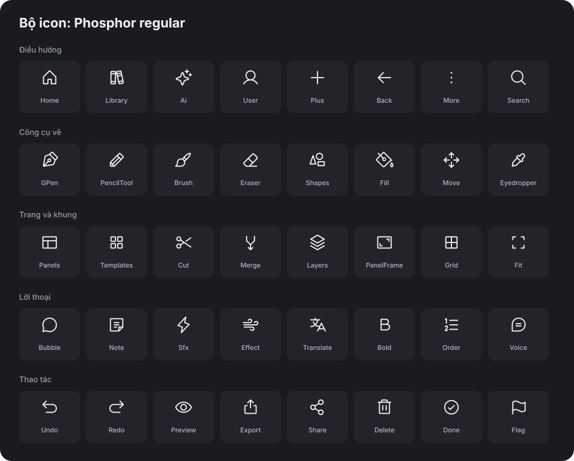

App dùng một bộ duy nhất là **Phosphor**, vì bộ này có nhiều độ đậm cùng một họ hình. Mọi icon khai ở `src/ui/icons.ts` và đặt tên theo ý nghĩa, ví dụ `UndoIcon`, nên đổi hình chỉ sửa một dòng.

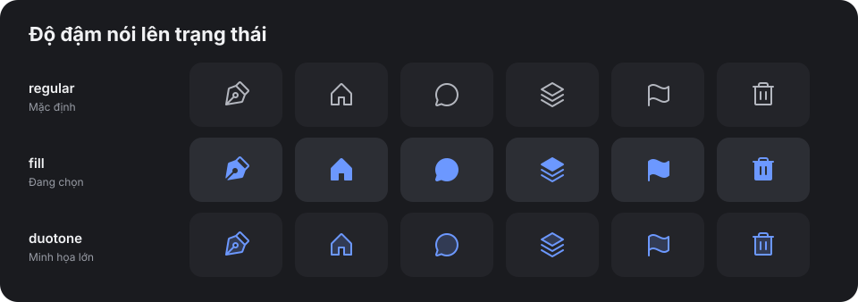

Độ đậm mang ý nghĩa, không phải trang trí:

- **`regular`** cho mọi icon ở trạng thái thường.
- **`fill`** cho mục đang chọn, nhờ vậy trạng thái không chỉ dựa vào màu. Người mù màu vẫn nhận ra.
- **`duotone`** cho icon lớn minh họa, như ở màn trống.

Các component dùng chung đã tự đổi độ đậm. Chỉ cần truyền `selected` hoặc `active`.

Cỡ icon theo thang `ICON`: `xs` 14, `sm` 16, `md` 20, `lg` 24, `xl` 32, `xxl` 40.

## Trong màn hình thật

| Màn | Điều cần để ý |
| --- | --- |
| 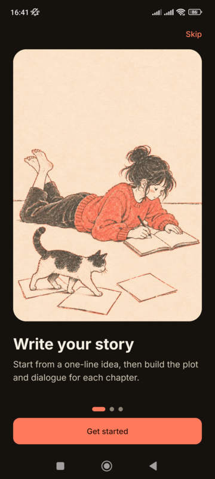 | **Onboarding.** Tranh chiếm phần lớn màn hình, kể câu chuyện trước khi nói về tính năng |
| 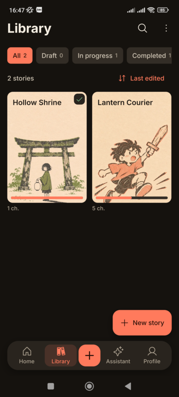 | **Library.** Bìa theo thể loại biến danh sách thành một kệ truyện. Tên in ở phần giấy trống phía trên |
| 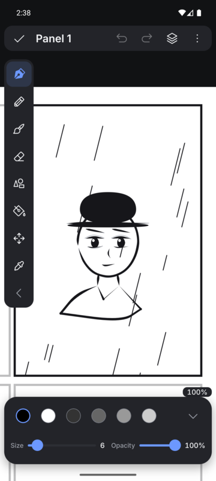 | **Canvas.** Tranh chiếm gần hết màn hình. Công cụ đang chọn là ngòi bút tô đặc, các công cụ khác giữ nét mảnh |
| 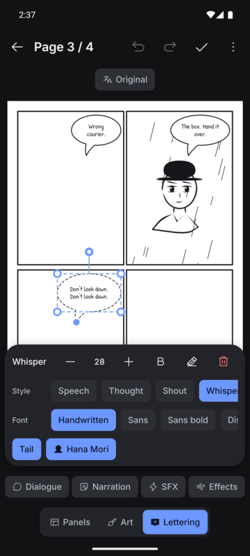 | **Lettering.** Thẻ thuộc tính nổi trên trang, và trang tự đẩy lên để bong bóng đang chọn luôn nhìn thấy, gồm cả đuôi và tay cầm |
| 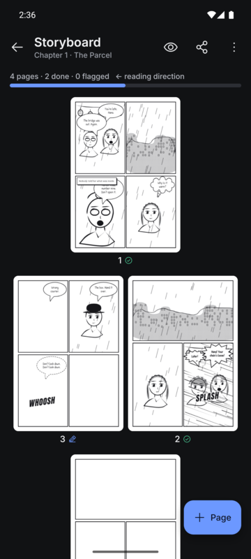 | **Storyboard.** Trang trắng nổi trên nền tối. Thứ tự đọc từ phải sang trái được ghi ngay đầu màn |
| 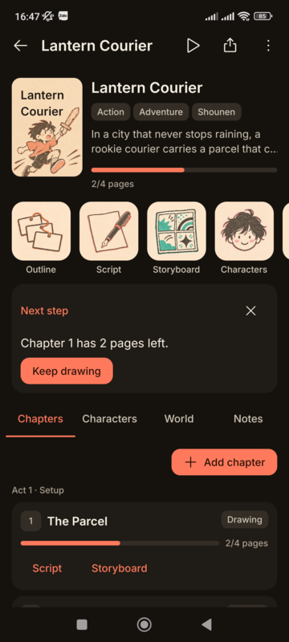 | **Project.** Hàng tile in riso đưa bạn tới từng phần của truyện, mỗi tile một màu mực |
| 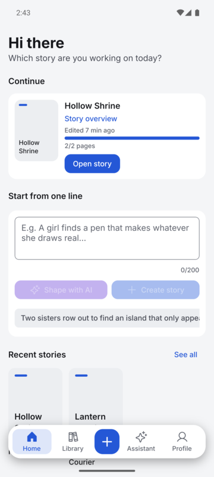 | **Giao diện giấy.** Cùng cấu trúc, cùng thứ bậc, nhưng tranh và nền hòa thành một tờ giấy |

## Nên và không nên

| Nên | Không nên |
| --- | --- |
| Dành màu nhấn cho một hành động chính mỗi màn | Tô màu nhấn lên nhiều nút cùng lúc |
| Dùng tranh riso cho các màn có cảm xúc | Dùng tranh neon, bóng bẩy hoặc có cảm giác AI |
| Tách bề mặt bằng độ sáng | Thêm viền quanh mọi thẻ |
| Đặt công cụ vào một hàng nếu còn chỗ | Để công cụ đè lên tranh |
| Làm màn trống có icon và bước tiếp theo | Để lại khoảng trống hoặc một ô xám |
| Dùng `fill` cho mục đang chọn | Chỉ đổi màu để báo trạng thái |
| Dùng token qua `className` | Viết mã màu, cỡ chữ hay bo góc trong màn hình |

## Giữ style về sau

Dự án có hai skill trong `.claude/skills/`:

- **`manganova-ui`** dùng khi dựng hoặc chỉnh màn hình. Có sẵn các bước kiểm tra trên máy.
- **`manganova-icons`** dùng khi thêm hay đổi icon.

Bảng màu và bảng icon trong tài liệu này được sinh từ code, nên sẽ không lệch với app:

```sh
python3 scripts/gen-style-assets.py
```

Kiểm tra giao diện phải chụp từ bản debug, vì bản release bật `FLAG_SECURE` nên ảnh chụp ra đen. Nên chụp trên máy thật dùng ba nút điều hướng: nhiều lỗi về chiều rộng và thanh hệ thống không thấy trên máy ảo. Các ảnh trong tài liệu này chụp từ Redmi Note 10S.
